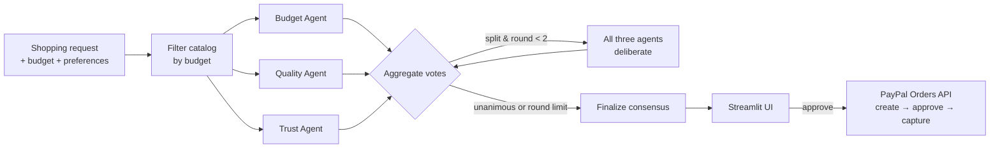

# 🛒 ConsensusCart

**Three AI shopping agents debate until they agree, then you check out with PayPal.**

Shopping assistants usually optimize one thing. ConsensusCart gives the decision to three agents with
competing priorities and makes them reach consensus in the open:

| Agent | Cares about |
|---|---|
| 💰 **Budget Agent** | Price relative to budget, value for money, hidden costs |
| ⭐ **Quality Agent** | Specs, features, fit with the user's stated preferences |
| 🛡️ **Trust Agent** | Seller rating, reviews, warranty, return policy, missing information |

Each agent picks independently first. If they disagree, every agent sees the others' reasoning and
reconsiders, for up to two deliberation rounds. Agents are told not to give in just because they're
outvoted, and to challenge claims the product data doesn't support. The winning product goes
straight to a PayPal Sandbox checkout.

## How it works



- **LangGraph** ([agents/orchestrator.py](agents/orchestrator.py)) runs the three agents in parallel, then loops
  through deliberation ([consensus/deliberation.py](consensus/deliberation.py)) until the agents agree
  unanimously or reach `MAX_DELIBERATION_ROUNDS`.
- **Structured output** ([agents/schema.py](agents/schema.py)): every agent returns a product ID, confidence,
  reasoning and trade-offs. Any product ID that isn't in the budget-filtered catalog is rejected, so agents
  can't hallucinate products or pick something over budget.
- **Consensus metrics** ([consensus/aggregation.py](consensus/aggregation.py)) record votes, agreement, and which
  agents changed their minds in each round. The winner is the plurality pick, with ties broken by total
  confidence. Remaining dissent is shown, not hidden.
- **PayPal checkout** ([payments/paypal.py](payments/paypal.py)) uses the Orders v2 REST API. The price comes from
  the server-side catalog, never from the browser. Capture is idempotent through `PayPal-Request-Id`, so
  refreshing the return page can't charge twice.

## Quick start

```bash
python3 -m venv .venv && source .venv/bin/activate
pip install -r requirements.txt
cp .env.example .env        # then fill in your keys
streamlit run app.py
```

Open http://localhost:8501, pick a category, describe what you want, and click **Find Best Products**.

### Environment variables

| Variable | Required | Purpose |
|---|---|---|
| `OPENAI_API_KEY` | yes | Runs the agents (`gpt-4.1-mini`) |
| `PAYPAL_CLIENT_ID` / `PAYPAL_CLIENT_SECRET` | for checkout | PayPal **Sandbox** REST app credentials |
| `APP_URL` | for checkout | Where PayPal returns the buyer (default `http://localhost:8501`) |
| `PAYPAL_BASE_URL` | no | Defaults to `https://api-m.sandbox.paypal.com` |

Without PayPal credentials, the app still runs the full agent consensus and shows that checkout is disabled.

### PayPal Sandbox setup

1. Sign in at [developer.paypal.com](https://developer.paypal.com/dashboard/) → **Apps & Credentials** →
   make sure **Sandbox** is selected → **Create App**. Copy the Client ID and Secret into `.env`.
2. Under **Testing Tools → Sandbox Accounts**, use the default *Personal* (buyer) account. Its email and
   password are what you log in with on the PayPal approval page.
3. In ConsensusCart, click **Buy with PayPal → Approve payment on PayPal**, log in as the sandbox buyer,
   and pay. PayPal sends you back to the app, which captures the order and shows the receipt.

## Tests

```bash
python3 -m pytest -q
```

All tests use scripted fake models, so they need no API keys and make no network calls. They cover:

- Budget filtering, rejection of hallucinated or over-budget product IDs, and preference passing
- Unanimity that skips deliberation, majority-to-unanimity, persistent dissent at the round limit, and tie-breaking
- Catalog parsing (missing data stays `None`, so the Trust Agent sees it as missing)
- PayPal order creation, capture, idempotency header, error handling, and order-ID validation
- The Streamlit app end to end via `streamlit.testing`: search → consensus → checkout → PayPal return/cancel

## Deploying (Streamlit Community Cloud)

1. Push the repo to GitHub, then create an app at [share.streamlit.io](https://share.streamlit.io) with `app.py` as the entry point.
2. In **Settings → Secrets**, add the variables as top-level keys (Streamlit exposes them as environment variables):
   ```toml
   OPENAI_API_KEY = "sk-..."
   PAYPAL_CLIENT_ID = "..."
   PAYPAL_CLIENT_SECRET = "..."
   APP_URL = "https://<your-app>.streamlit.app"
   ```

## Project layout

```
app.py                     Streamlit UI: search, live agent progress, consensus, checkout, receipt
agents/                    Budget, Quality and Trust agents, shared state/schema, LangGraph orchestrator
consensus/                 Aggregation, deliberation loop, voting metrics
data/products.csv          Demo catalog (18 products across headphones, laptops, coffee makers)
data/catalog.py            Catalog loader
payments/paypal.py         PayPal Orders v2 client (Sandbox)
tests/                     pytest suite (no keys needed)
```

## Limitations

- The catalog is a small **fictional demo dataset**. Brands, sellers, ratings and prices are made up. A real
  deployment would plug in a product search API.
- Checkout uses the PayPal **Sandbox**, and no real money moves.
- Each search makes 3–9 LLM calls (3 independent picks plus up to 2 rounds of 3 deliberations).
